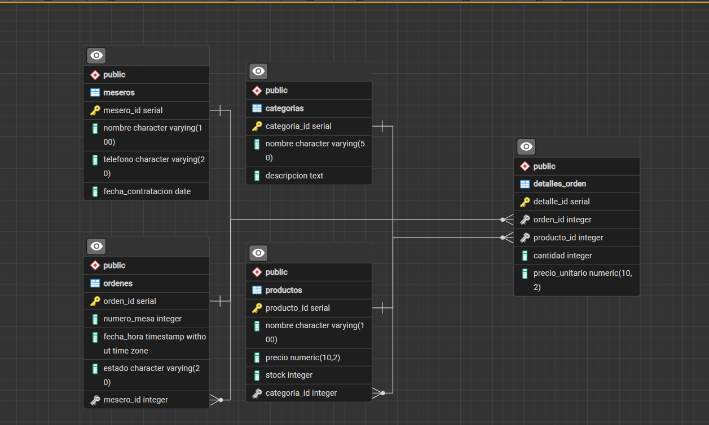
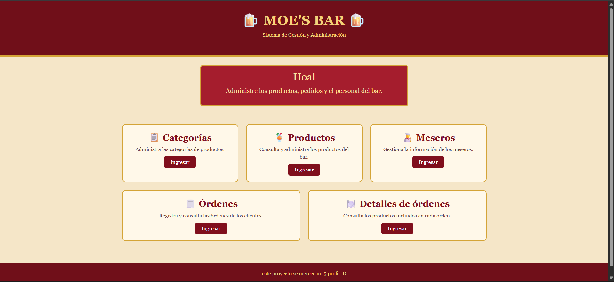
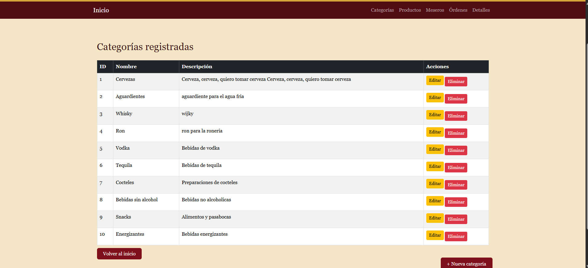
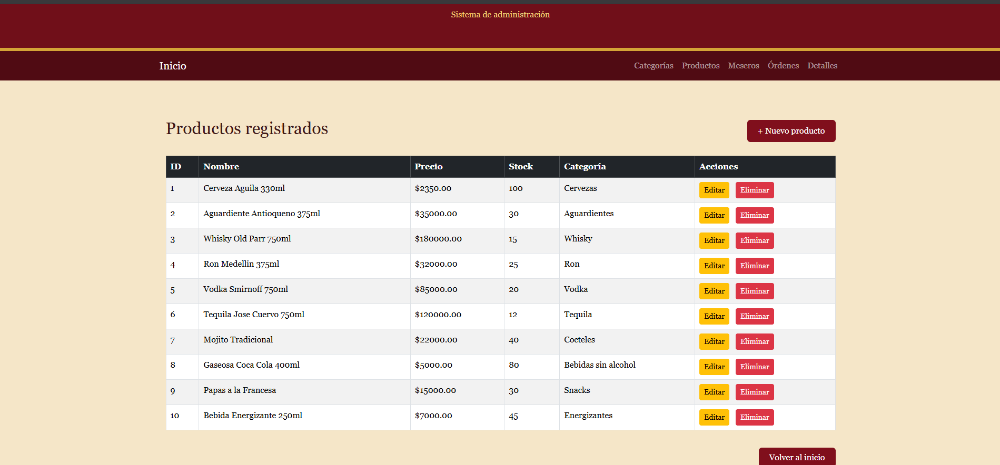
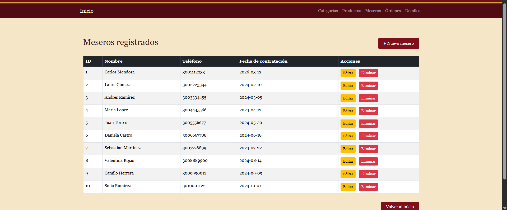
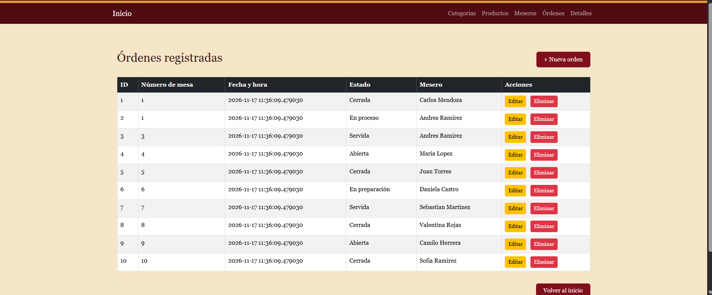
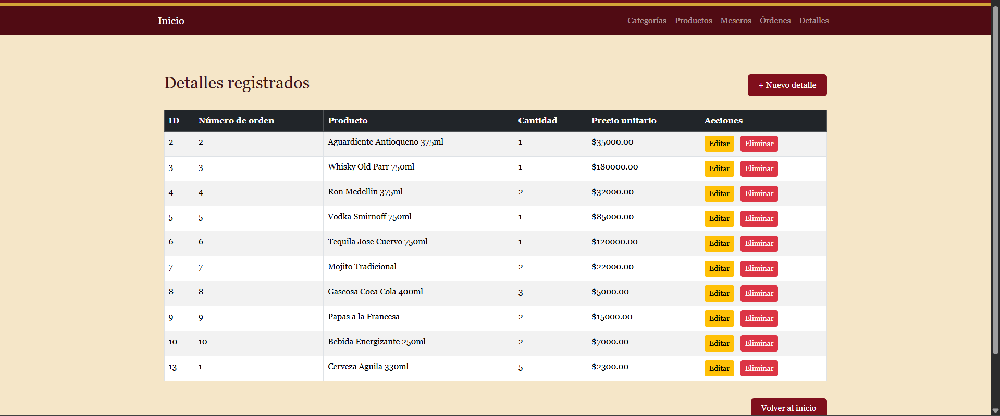

# 🍺 MOE'S BAR

## Sistema de gestion y administración de un bar

MOE'S BAR es una aplicación web desarrollada como proyecto académico. Permite administrar la información de un establecimiento mediante operaciones CRUD (crear, consultar, actualizar y eliminar).

El sistema utiliza Flask como framework web y PostgreSQL como sistema gestor de bases de datos.

## 1. Tecnologias utilizadas

- **Python 3.14:** lenguaje de programación.
- **Flask 3.1.3:** desarrollo de la aplicación web.
- **PostgreSQL:** gestión de la base de datos.
- **Psycopg2:** conexión entre Python y PostgreSQL.
- **HTML y CSS:** estructura y diseño de las páginas.
- **Bootstrap 5.3.3:** diseño adaptable de la interfaz.
- **Pytest 9.2.0:** ejecución de pruebas automatizadas.

## 2. Funcionalidades

El sistema permite administrar cinco módulos:

1. **Categorias:** registrar, consultar, editar y eliminar categorías.
2. **Productos:** administrar productos, precios, existencias y categorías.
3. **Meseros:** gestionar la información del personal.
4. **ordenes:** registrar y administrar las órdenes de las mesas.
5. **Detalles de órdenes:** relacionar los productos con las órdenes, indicando cantidades y precios.

Tambien incluye validaciones para evitar registros con información incorrecta y restricciones relacionadas con las relaciones entre las tablas.

├── docs/
│   ├── capturas/
│   │   ├── inicio.png
│   │   ├── categorias.png
│   │   ├── productos.png
│   │   ├── meseros.png
│   │   ├── ordenes.png
│   │   └── detalles_orden.png
│   │
│   ├── evidencias/
│   ├── Diccionario-justificaciones.docx
│   ├── MER_bd.png
│   ├── plan_pruebas.md
│   └── resultado_pytest.txt

## 4. Requisitos previos

Para ejecutar el proyecto se necesita:

- Python 3.14.
- PostgreSQL.
- Una base de datos llamada `proyecto_pw_bar`.
- Git (opcional, para clonar el repositorio).

## 5. Instalacion

### 5.1. Descargar el proyecto

Clonar el repositorio:

```bash
git clone https://github.com/gpr208/proyecto_final_pw.git
```

Entrar a la carpeta:

```bash
cd proyecto_final_pw
```

### 5.2. Crear el entorno virtual

En Windows PowerShell:

```powershell
python -m venv .venv
```

Activar el entorno virtual:

```powershell
.\.venv\Scripts\Activate.ps1
```

### 5.3. Instalar las dependencias

Ejecutar:

```powershell
pip install -r requirements.txt
```

## 6. Configuración de PostgreSQL

### 6.1. Crear la base de datos

Desde PostgreSQL o pgAdmin, crear una base de datos con el siguiente nombre:

```sql
CREATE DATABASE proyecto_pw_bar;
```

### 6.2. Importar el respaldo

El proyecto incluye el archivo:

```text
database/backup.sql
```
Este archivo contiene la estructura y los datos de la base de datos.
Para restaurarlo desde pgAdmin:

1. Abrir la base de datos `proyecto_pw_bar`.
2. Abrir la herramienta Query Tool.
3. Abrir el archivo `database/backup.sql`.
4. Ejecutar el contenido del archivo.

### 6.3. Configurar las variables de conexión

Crear una copia del archivo de ejemplo:

```powershell
Copy-Item .env.example .env
```

Abrir `.env` y configurar los datos de conexión:

```env
DB_HOST=localhost
DB_PORT=5432
DB_NAME=proyecto_pw_bar
DB_USER=postgres
DB_PASSWORD=coloca_tu_contrasena_aqui
```

Reemplazar el valor de `DB_PASSWORD` por la contraseña configurada en PostgreSQL.

**Importante:** el archivo `.env` contiene información privada y no debe subirse al repositorio de GitHub.

## 7. Ejecutar la aplicación

Con el entorno virtual activado y la base de datos configurada, ejecutar:

```powershell
python run.py
```

Abrir el navegador y visitar:

```text
http://127.0.0.1:5000/
```

Desde la página principal se puede acceder a los cinco módulos del sistema.

## 8. Pruebas automatizadas

El proyecto cuenta con pruebas automatizadas desarrolladas mediante Pytest.

Para ejecutarlas, utilizar:

```powershell
python -m pytest -v
```

Las pruebas comprueban:

- Funcionamiento de la página principal.
- Consulta de categorías, productos, meseros, órdenes y detalles.
- Registro de información válida.
- Rechazo de algunos datos que incumplen las validaciones.
Actualmente se cuenta con **17 pruebas automatizadas**.
Las pruebas utilizan conexiones simuladas para evitar modificar la base de datos real.
## 9. Documentación adicional

En la carpeta `docs/` se encuentra la documentación complementaria del proyecto:

- **Diccionario-justificaciones.docx:** contiene el diccionario de datos y las justificaciones del diseño de la base de datos.
- **MER_bd.png:** contiene el modelo entidad-relación de la base de datos.
- **plan_pruebas.md:** describe las pruebas manuales realizadas en el sistema.
- **resultado_pytest.txt:** contiene los resultados de las pruebas automatizadas.
- **evidencias/:** almacena las capturas de pantalla de las pruebas manuales.

El proyecto también incluye el respaldo SQL y los archivos correspondientes a las pruebas automatizadas.

## 10. Modelo Entidad-Relación (MER)
A continuación, se presenta el modelo entidad-relación de la base de datos de MOE'S BAR:



## 11. Capturas de la aplicación

### Página principal



### Gestión de categorías



### Gestión de productos



### Gestión de meseros



### Gestión de órdenes



### Gestión de detalles de órdenes



## 12. Repositorio

**GitHub:** https://github.com/gpr208/proyecto_final_pw.git

---

**Proyecto académico – MOE'S BAR**
creado por Gabriel Eduardo Perdomo Reyes y Miguel Angel Muñoz Guevara
copyright 2026